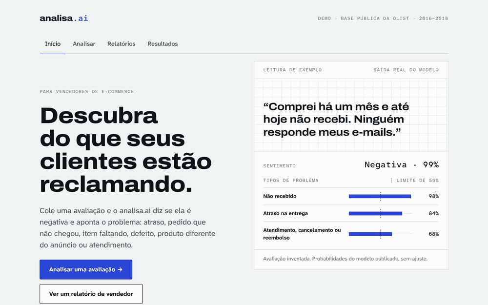
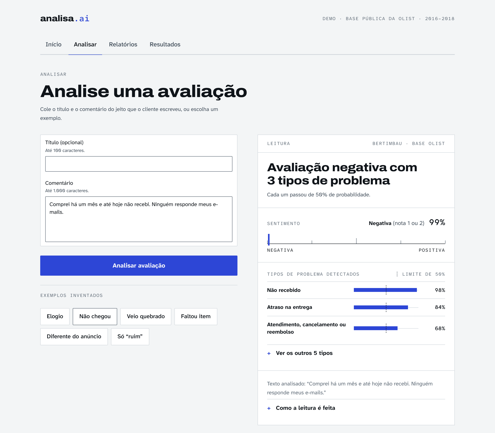
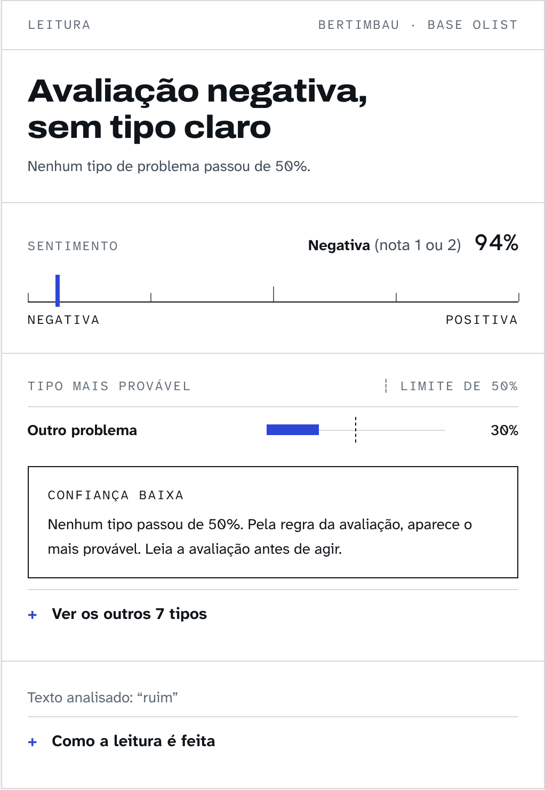
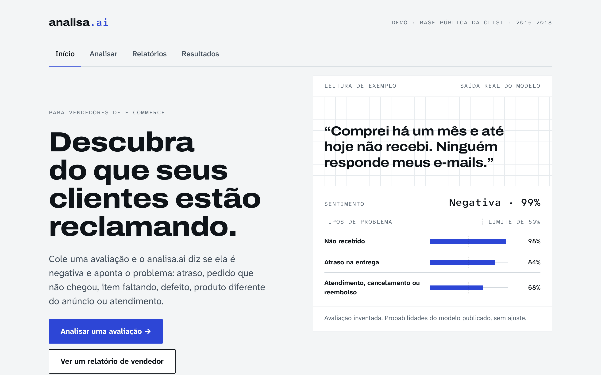
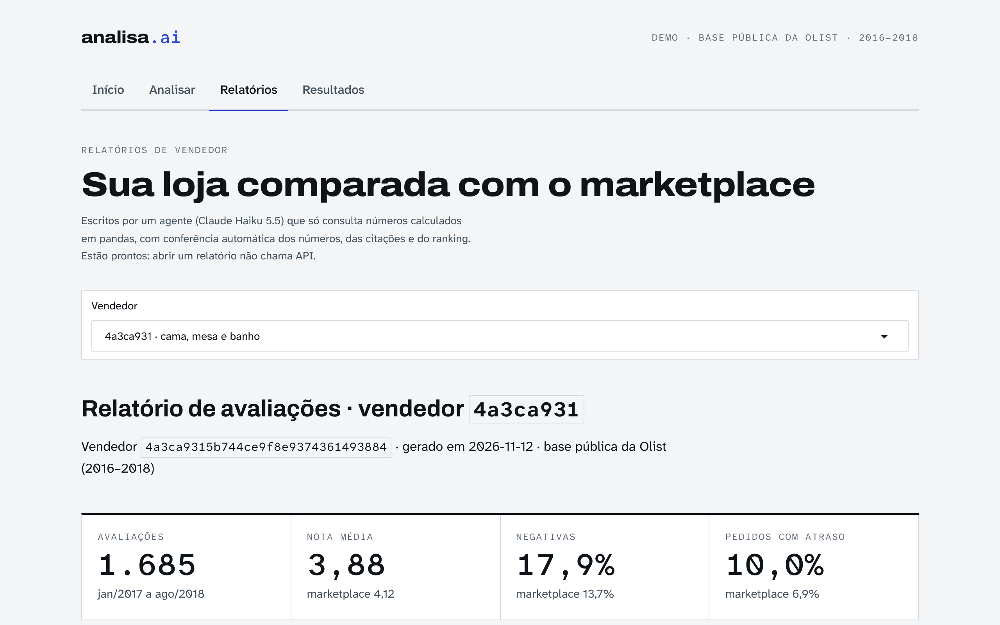
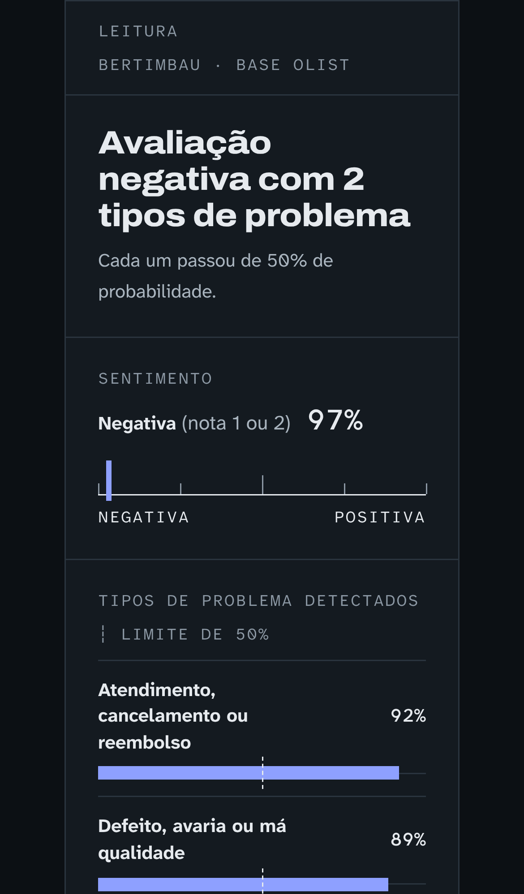
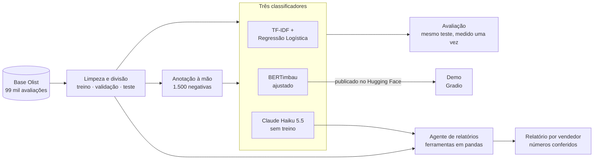

# analisa.ai

**Analisador de avaliações de e-commerce com IA.** Lê o que os clientes escreveram, diz
se a avaliação é negativa, aponta o que deu errado (atraso, defeito, item faltando…) e
escreve um relatório para cada vendedor, com todos os números conferidos.

[](https://github.com/gabrielmarcone/analisa.ai-analisador-avaliacoes/actions/workflows/ci.yml)

[](https://huggingface.co/gmarconems)
[](LICENSE)
[](#dados-e-licença)



## Sumário

- [O problema](#o-problema)
- [Resultados](#resultados)
- [A demo](#a-demo)
- [Como funciona](#como-funciona)
- [Tecnologias](#tecnologias)
- [Como executar](#como-executar)
- [Como foi feito](#como-foi-feito)
- [Qualidade e segurança](#qualidade-e-segurança)
- [Estrutura do repositório](#estrutura-do-repositório)
- [Dados e licença](#dados-e-licença)

## O problema

Um marketplace recebe milhares de avaliações por mês. A nota diz **se** o cliente ficou
insatisfeito, mas não **por quê**, e é o porquê que o vendedor precisa para corrigir
alguma coisa: o produto chega atrasado? Chega quebrado? Vem faltando peça? Ler tudo à mão
não escala.

O analisa.ai usa as cerca de 99 mil avaliações reais da [base pública da Olist](https://www.kaggle.com/datasets/olistbr/brazilian-ecommerce)
(2016–2018) para responder a três perguntas:

1. **A avaliação é positiva ou negativa?** Classificação de sentimento a partir do texto.
2. **Qual foi o problema?** Oito tipos de problema, e uma mesma avaliação pode ter vários
   ("atrasou e ainda veio quebrado").
3. **O que cada vendedor deve corrigir primeiro?** Um relatório por vendedor, escrito por
   um agente de IA, em que cada número vem dos dados e é conferido automaticamente.

Além de resolver o problema, o projeto compara de forma justa três abordagens: um modelo
clássico (TF-IDF), um modelo de linguagem ajustado aos dados (BERTimbau) e um LLM sem
treino nenhum (Claude Haiku 5.5). As três são medidas no mesmo conjunto de teste, uma
única vez.

## Resultados

F1 macro no conjunto de teste (quanto mais perto de 1, melhor):

| Tarefa | TF-IDF + Regressão Logística | BERTimbau ajustado | Claude Haiku 5.5 sem treino |
|---|---:|---:|---:|
| Sentimento (3.712 avaliações) | 0,930 | **0,947** | 0,935 |
| Tipo de problema (500 avaliações anotadas) | 0,678 | 0,696 | **0,881** |
| Custo por mil avaliações | grátis | grátis (roda em CPU) | US$ 0,01 a 0,05 |

- **Sentimento: vence o BERTimbau.** Treinado com quase 30 mil avaliações, ele aprende
  padrões que o LLM não tem como saber, como o cliente que reclama no texto mas dá nota
  alta.
- **Tipo de problema: o LLM sem treino vence com folga.** Só com as regras do guia de
  anotação e nenhum exemplo, ele supera os modelos treinados com 750 avaliações. Com
  poucos dados rotulados, regras explícitas valeram mais que exemplos.
- **Relatórios para vendedores:** gerados para os três vendedores com mais avaliações
  negativas, a menos de US$ 0,02 cada.

| Vendedor | Categoria principal | Avaliações | Negativas | Problema mais citado nas negativas com comentário |
|---|---|---:|---:|---|
| [`4a3ca931`](reports/relatorios/vendedor_4a3ca931.md) | cama, mesa e banho | 1685 | 17,9% | Não recebido (36,4%) |
| [`6560211a`](reports/relatorios/vendedor_6560211a.md) | relógios e presentes | 1802 | 16,6% | Defeito ou má qualidade (37,1%) |
| [`cc419e06`](reports/relatorios/vendedor_cc419e06.md) | beleza e saúde | 1683 | 14,7% | Não recebido (35,6%) |

No marketplace todo, 13,7% das avaliações são negativas. A análise completa, com F1 por
categoria, latência, intervalo de confiança e cuidados de leitura, está em
[`docs/metodologia.md`](docs/metodologia.md#resultados-em-detalhe). Os modelos estão
publicados no Hugging Face:
[`bertimbau-olist-sentimento`](https://huggingface.co/gmarconems/bertimbau-olist-sentimento) e
[`bertimbau-olist-problemas`](https://huggingface.co/gmarconems/bertimbau-olist-problemas).

## A demo

Uma interface web classifica qualquer avaliação digitada: o sentimento e, se for negativa,
os tipos de problema, com as probabilidades. Ela também mostra os relatórios dos
vendedores e a tabela de resultados. Roda no seu computador, sem custo e sem chave de API
([como abrir](#1-abrir-a-demo)).

| Análise de uma avaliação | Confiança baixa |
|---|---|
|  |  |

| Tela inicial | Relatório de vendedor | Celular, tema escuro |
|---|---|---|
|  |  |  |

As probabilidades nos prints e no vídeo são as que os modelos publicados deram para esses
exemplos, gravadas em [`reports/demo_conferencia.json`](reports/demo_conferencia.json).

## Como funciona



1. **Dados.** A base é baixada do Kaggle, limpa e dividida em treino, validação e teste
   (80/10/10). Textos repetidos, como "Recomendo", ficam sempre no mesmo conjunto, para o
   teste não premiar memorização.
2. **Anotação.** A base não diz qual foi o problema, então 1.500 avaliações negativas foram
   rotuladas à mão em 8 categorias, seguindo um [guia escrito antes](docs/guia_anotacao.md).
   Uma segunda rodada mediu a consistência (kappa ≥ 0,87 em todas as categorias).
3. **Três classificadores, uma régua.** Os três modelos usam a mesma divisão, as mesmas
   regras de previsão e as mesmas métricas (`evaluate.py`). Os ajustes são escolhidos na
   validação; o teste é medido uma única vez.
4. **Agente de relatórios.** As contas são feitas em pandas, e o Claude só consulta essas
   ferramentas e escreve o texto. Depois, o código confere cada número, cada citação e
   cada ranking do relatório contra os dados; o que não bater faz o agente reescrever.
5. **Demo.** Usa os dois BERTimbau publicados, em CPU, com o mesmo código de previsão da
   avaliação. O comando `conferir` prova que ela reproduz o F1 medido.

| Parte | Módulos em `src/reviews/` |
|---|---|
| Dados | `download.py`, `data.py`, `prepare.py`, `splits.py`, `labels.py` |
| Anotação | `annotation.py`, `annotate_app.py` |
| Avaliação | `evaluate.py` |
| Modelos | `baseline.py`, `bert.py`, `llm.py`, `llm_prompts.py` |
| Relatórios | `sellers.py`, `agent.py` |
| Demo | `demo.py`, `demo_ui.py`, `demo.css` |

Cada decisão, com o motivo, está em [`docs/metodologia.md`](docs/metodologia.md).

## Tecnologias

**Linguagem e dados**


**Aprendizado de máquina e IA**


**Interface**


**Qualidade**


| Peça | Para quê |
|---|---|
| **BERTimbau** (`neuralmind/bert-base-portuguese-cased`) | Modelo de linguagem em português, ajustado às duas tarefas numa GPU do Colab |
| **Claude Haiku 5.5** | Classificação sem treino e redação dos relatórios, com saída em JSON validada |
| **Gradio** | Demo web com identidade visual própria, acessível (WCAG AA) e com tema escuro |
| **pre-commit, Ruff e pytest** | Formatação, lint e 183 testes automatizados, rodados na CI |

## Como executar

Precisa de **Python 3.12 ou 3.13** e Git. Os comandos abaixo funcionam no Git Bash
(Windows), no Linux e no macOS.

### 1. Abrir a demo

Não precisa da base do Kaggle nem de chave de API: os modelos são baixados do Hugging
Face na primeira vez (cerca de 900 MB), e os resultados e relatórios já estão no
repositório.

```bash
git clone https://github.com/gabrielmarcone/analisa.ai-analisador-avaliacoes.git
cd analisa.ai-analisador-avaliacoes

python -m venv .venv
source .venv/Scripts/activate        # Git Bash no Windows (PowerShell: .venv\Scripts\Activate.ps1)
# source .venv/bin/activate          # Linux ou macOS

pip install torch --index-url https://download.pytorch.org/whl/cpu   # PyTorch só para CPU
pip install -r requirements.txt "transformers==5.22.1"               # a versão que salvou os modelos
pip install -e .

python -m reviews.demo               # abre em http://127.0.0.1:7860
```

A demo só escuta no seu computador (`127.0.0.1`) e não cria link público. A API
`/classificar` devolve a mesma previsão em JSON.

### 2. Reproduzir o projeto

Para baixar a base e rodar as análises e os testes, instale também as ferramentas de
desenvolvimento e entre no Kaggle uma vez:

```bash
pip install -r requirements-dev.txt
kaggle auth login                    # uma vez, abre o navegador

python -m reviews.download           # baixa a base para data/raw/
python -m reviews.prepare            # gera data/processed/reviews.parquet
pytest                               # roda os testes
```

Sem o `accelerate` (em `requirements-bert.txt`), o teste de treino do BERTimbau é pulado;
os demais rodam normalmente.

A análise exploratória está em [`notebooks/01_eda.ipynb`](notebooks/01_eda.ipynb).

### 3. Cada etapa

Os comandos com `--teste` medem no conjunto de teste e devem rodar uma única vez por
modelo; sem essa opção, medem só na validação.

<details>
<summary><b>Anotação</b></summary>

```bash
python -m reviews.annotation fila      # sorteia as 1.500 avaliações a anotar (uma vez)
python -m reviews.annotate_app         # abre o app de anotação no navegador
python -m reviews.annotation status    # mostra o progresso
python -m reviews.annotation concordancia   # kappa entre as duas rodadas
```

As regras estão em [`docs/guia_anotacao.md`](docs/guia_anotacao.md).
</details>

<details>
<summary><b>Baseline (TF-IDF)</b></summary>

```bash
python -m reviews.baseline sentimento --teste
python -m reviews.baseline problemas --teste
python -m reviews.baseline curva                # curva de aprendizado
```
</details>

<details>
<summary><b>BERTimbau</b></summary>

O treino precisa de GPU e roda no Google Colab:
[`notebooks/02_bertimbau_colab.ipynb`](notebooks/02_bertimbau_colab.ipynb). O notebook
explica cada passo, do token do Hugging Face ao envio dos resultados.

```bash
python -m reviews.bert sentimento --teste
python -m reviews.bert problemas --teste
python -m reviews.bert publicar --usuario SEU_USUARIO_HF           # envia modelos e model cards
python -m reviews.bert cards --usuario SEU_USUARIO_HF --simular    # mostra os model cards
python -m reviews.bert cards --usuario SEU_USUARIO_HF              # atualiza só os model cards
```

O envio pede um token de escrita do Hugging Face na variável `HF_TOKEN` (ou no `.env`).
</details>

<details>
<summary><b>LLM sem treino (Claude Haiku 5.5)</b></summary>

Copie `.env.example` para `.env` e preencha `ANTHROPIC_API_KEY`. O `.env` não vai para o
Git.

```bash
python -m reviews.llm verificar                            # testa a chave (custo ~US$ 0,0001)
python -m reviews.llm problemas --simular                  # mostra o plano, sem chamar a API
python -m reviews.llm problemas --esforco medium           # validação
python -m reviews.llm problemas --esforco medium --teste   # teste, com o esforço escolhido
python -m reviews.llm sentimento --esforco low --teste
```

Há uma trava de gasto por execução (`--limite-usd`, padrão US$ 2), e as respostas ficam
em cache: se a execução cair, ela continua de onde parou sem pagar de novo.
</details>

<details>
<summary><b>Relatórios para vendedores</b></summary>

```bash
python -m reviews.agent vendedores                    # quem tem mais avaliações negativas
python -m reviews.agent relatorio --top 3 --simular   # mostra os números, sem chamar a API
python -m reviews.agent relatorio --top 3             # gera os relatórios em reports/relatorios/
python -m reviews.agent conferir                      # reconfere os relatórios, sem API
```
</details>

<details>
<summary><b>Conferir a demo</b></summary>

```bash
python -m reviews.demo conferir      # mede os modelos publicados no teste (precisa da base)
```

Compara o F1 dos modelos do Hugging Face, rodando com o código da demo, com o registrado
em `reports/resultados.json`.
</details>

## Como foi feito

O projeto foi construído em fases, cada uma com testes, revisão e uma versão marcada no
Git:

| Fase | O que foi feito | Versão |
|---|---|---|
| 1. Dados | Download, limpeza, rótulo de sentimento, divisão agrupada por texto e análise exploratória | |
| 2. Anotação | Guia de anotação, app próprio, 1.500 avaliações rotuladas e medida de concordância | `v0.0-anotacao` |
| 3. Baseline | TF-IDF + Regressão Logística e curva de aprendizado | `v0.1-baseline` |
| 4. BERTimbau | Ajuste fino no Colab e publicação dos modelos no Hugging Face | `v0.2-bertimbau` |
| 5. LLM | Claude Haiku 5.5 sem treino, em lotes, com controle de custo | `v0.3-llm` |
| 6. Agente | Relatórios por vendedor com ferramentas em pandas e conferência automática | `v0.4-agente` |
| 7. Entrega | Demo em Gradio, integração contínua, model cards e esta documentação | `v1.0.0` |

Algumas regras guiaram todas as fases:

- **O teste é sagrado.** Cada modelo é medido no teste uma única vez, e nenhum ajuste é
  feito olhando para ele. O teste foi anotado 100% à mão, sem ajuda de LLM, para não
  favorecer o LLM na comparação.
- **Mesma régua para todos.** Mesma divisão, mesmas regras de previsão e mesmas funções de
  métrica para os três modelos.
- **Nenhum número digitado à mão.** Resultados, model cards, tela inicial da demo e
  relatórios leem os mesmos arquivos de resultados.
- **O LLM não faz contas.** No agente, os números vêm do pandas; o modelo só escreve, e o
  código confere o que ele escreveu.

Os detalhes de cada fase, os resultados completos e a tabela de decisões estão em
[`docs/metodologia.md`](docs/metodologia.md).

## Qualidade e segurança

- **183 testes automatizados**, inclusive o treino e a demo com BERTs minúsculos criados
  na hora, sem baixar nada.
- **Integração contínua** no GitHub Actions a cada push, a cada PR e toda semana: lint,
  testes em Python 3.12 e 3.13, testes com PyTorch e auditoria de vulnerabilidades nas
  dependências (`pip-audit`).
- **Sem segredos no código.** As chaves ficam só no `.env`, fora do Git, e a CI não usa
  nenhuma. As ações da CI são fixadas pelo commit, com permissão só de leitura.
- **Entradas tratadas como dados.** Os textos das avaliações nunca viram instruções para
  o LLM, e o texto digitado na demo é escapado e não é guardado.
- **Gasto controlado.** Trava de custo por execução no LLM e no agente, e cache das
  respostas da API.

## Estrutura do repositório

```
src/reviews/      código do projeto (dados, anotação, avaliação, modelos, agente, demo)
tests/            testes automatizados
notebooks/        análise exploratória (01) e treino do BERTimbau no Colab (02)
annotations/      fila e rótulos da anotação (só IDs, sem texto)
splits/           IDs da divisão treino/validação/teste
reports/          resultados, figuras, conferência da demo e relatórios dos vendedores
docs/             metodologia, guia de anotação, prints e vídeo da demo
.github/          integração contínua e Dependabot
```

A base e os modelos treinados não ficam no repositório: a base é baixada pelo script, e
os modelos estão no Hugging Face.

## Dados e licença

- **Dados:** [Brazilian E-Commerce Public Dataset by Olist](https://www.kaggle.com/datasets/olistbr/brazilian-ecommerce),
  publicado pela Olist no Kaggle sob a licença **CC BY-NC-SA 4.0** (uso não comercial). Os
  nomes de loja da base são pseudônimos criados pela Olist.
- **Código:** [licença MIT](LICENSE).
- **Modelos, anotações e relatórios:** derivados da base, seguem a mesma CC BY-NC-SA 4.0.

---

Feito por **Gabriel Marcone Magalhães Santos**, estudante de Ciência da Computação na
UESB · [GitHub](https://github.com/gabrielmarcone) ·
[Hugging Face](https://huggingface.co/gmarconems)
